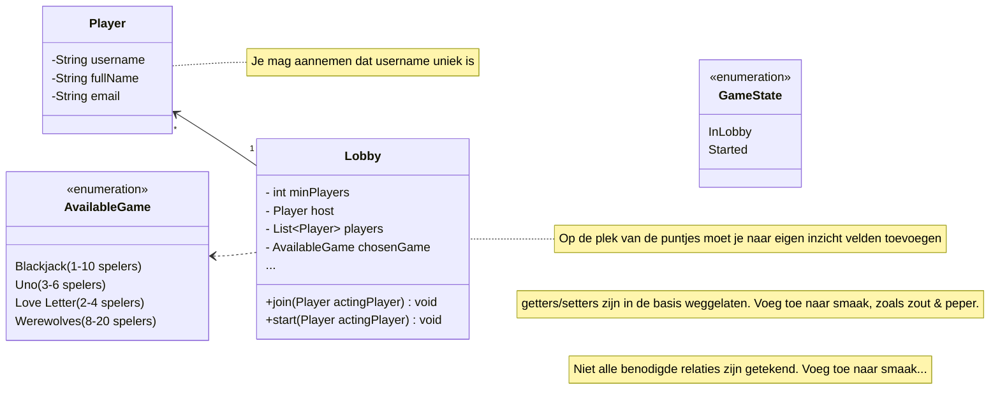

# Oefenopdracht OOP (30min)

In deze oefenopdracht willen we weer even een klein beetje oefenen met Java en OOP.

Je kunt een nieuw Project aanmaken in IntelliJ via ```New Project / Java / Maven```

## Schets



## Requirements

* De Host is ook altijd 1 van de players
* Alleen de Host mag de game starten, en alleen als aan het min. aantal spelers is voldaan
* Er mogen niet meer dan het max. aantal spelers joinen
* Nadat het spel is gestart mogen spelers niet meer joinen
* Er mogen geen dubbele spelers (met dezelfde username) in de lobby

Klaar? Hand omhoog, docent checkt het even.
Was het goed? Top, jij bent nu ook (even) docent.
