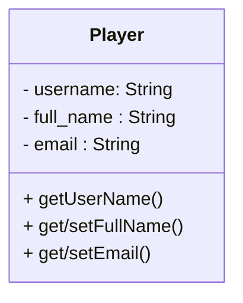
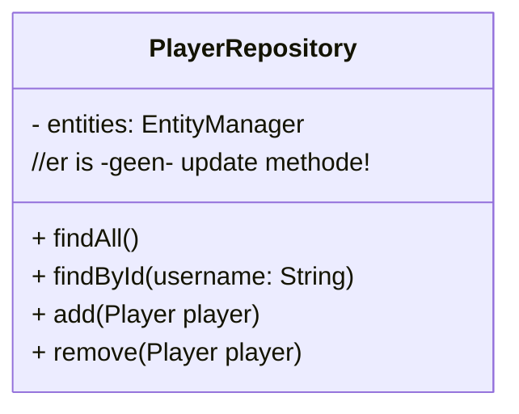
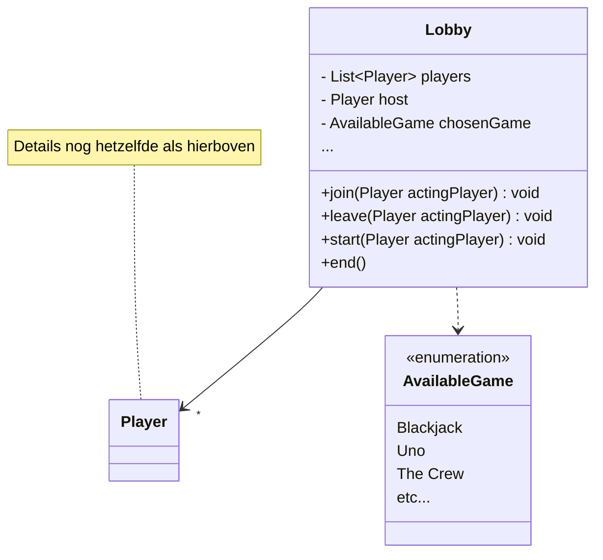

# ORMs


## Opdracht 0: Database

### H2

We gebruiken als database H2.
De H2 database is een in-memory database, die -in- je webserver leeft. Je kunt erbij door naar http://localhost:8080/h2-console/
te gaan in je browser. De connectie-settings kun je vinden in de application.properties.

Nouja, bijna werkt het. Spring Security moet nog even verteld worden dat de H2 console gebruikt mag worden:

```java
http.csrf(csrf -> csrf.disable()) //CSRF is wat veel voor nu, maar de standaard H2 frontend support het gewoon niet
        .headers(c -> {
            c.frameOptions(frame -> frame.disable()); //Standaard mag je van Spring geen dingen in een Iframe stoppen, 3x raden wat de H2-frontend doet?
        })
    .authorizeHttpRequests(a -> a.requestMatchers("/h2-console/**").permitAll()) //En uiteraard moeten alle h2-urls doorgelaten worden
```
Door dit **tussen** de chain te proppen kun je de H2 console gebruiken
(let dus op dat je niet per ongeluk een tweede chain maakt die je niet returnt).

### Docker
Tot nu toe gebruikten we H2, een In-Memory database. Het nadeel hiervan is dat je elke applicatie-herstart al je data kwijt bent.

* Probeer met de Docker-Compose file een PostGres database op te starten. Pas de application-properties aan zodat de postgres database gebruikt wordt.

Als je nu de applicatie afsluit en opnieuw opstart zou je data gewoon bewaard moeten worden.

* Waarschijnlijk heb je nog PGAdmin van S2 op je laptop staan. Probeer met PGAdmin te connecten op de Postgres database van de container. (als je geen PGAdmin meer hebt zit er ook een ingebouwde database-client in IntelliJ)

Wat vind je fijner als Developer? H2 of Postgres+Docker? Voor deze oefenopdrachten zijn alletwee prima. Persoonlijk geef ik
de voorkeur aan H2 voor oefencode.

## Opdracht 1: PlayerRepository



We gaan in een aantal stappen kennismaken met ORMs.

* Zet logging aan in de application.properties:
```text
spring.jpa.properties.hibernate.format_sql=true
logging.level.org.hibernate.SQL=DEBUG
logging.level.org.hibernate.type.descriptor.sql.BasicBinder=TRACE
logging.level.org.hibernate.orm.jdbc.bind=TRACE
```

* Voeg een @Entity annotatie toe op Player. Voeg ook een @Id toe aan de username. Je zult wat @Table en @Column annotaties moeten toevoegen om de gegenereerde tabel en column-names overeen te laten komen met de selects/insert/updates.

* We gaan de DAO vervangen door een Repository. Maak een class PlayerRepository aan. Gebruik "Dependency Injection" om een ```Entity Manager``` in deze class te injecteren en implementeer de volgende methodes:



* Voeg @Transactional toe aan de ```PlayerController```, en injecteer je PlayerRepository naast de DAO. Herschrijf de methodes zodat alle functionaliteit weer werkt!
  Zodra alles werkt kun je de DAO-injectie verwijderen. In een echte applicatie zou @Transactional waarschijnlijk in de
  service-laag eindigen, maar die willen we hier niet verplichten (maar hey, als je 'm toch hebt...)

* Merk op hoe je PUT methode werkt, zonder dat er een update-method nodig is. Waarom zou dat werken?

## Opdracht 2 (Huiswerk: skip in de les): LobbyDAO

De LobbyController gebruikt nu nog puur een in-memory list. Maak (en gebruik!) een LobbyDAO class om vergelijkbaar aan de PlayerDAO lobbies te kunnen beheren.

Dit is een pittige opdracht, en vereist een non-triviale hoeveelheid code. Timebox dit op max. 2 uur werk.
Het is wel aan te raden om er in elk geval aan te beginnen, zodat je een goed idee hebt welk probleem een ORM eigenlijk voor je oplost!

## Opdracht 3: Relaties



Nu is het tijd om de Lobby, en de relatie toe te voegen. We volgen dezelfde stappen als hierboven.

* Zorg eerst dat je de Lobby tabellen kan aanmaken. Gebruik JPA annotaties zoals @Id, @Table, @Column, @Enumerated, @One-to-Many, @Many-to-One en/of @Many-to-Many om de juiste tabelstructuur te maken. De koppeltabel kun je specificeren met @JoinTable, die is een beetje lastig.

* Maak een LobbyRepository class aan, zoals hierboven voor Players, en migreer de controller naar de LobbyRepository class.

* Welke Cascade zou je kunnen toevoegen aan de relatie tussen Lobby en Player? En welke *zeker niet*?

* Optioneel: Gebruik in plaats van zelf-gemaakte classes de Automagische JPA-interface-Repositories voor Player/Lobby